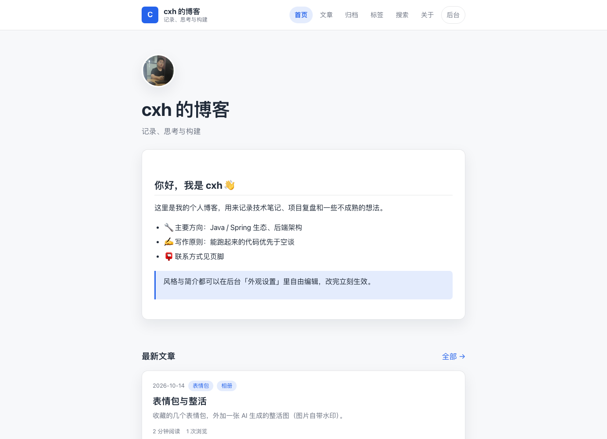
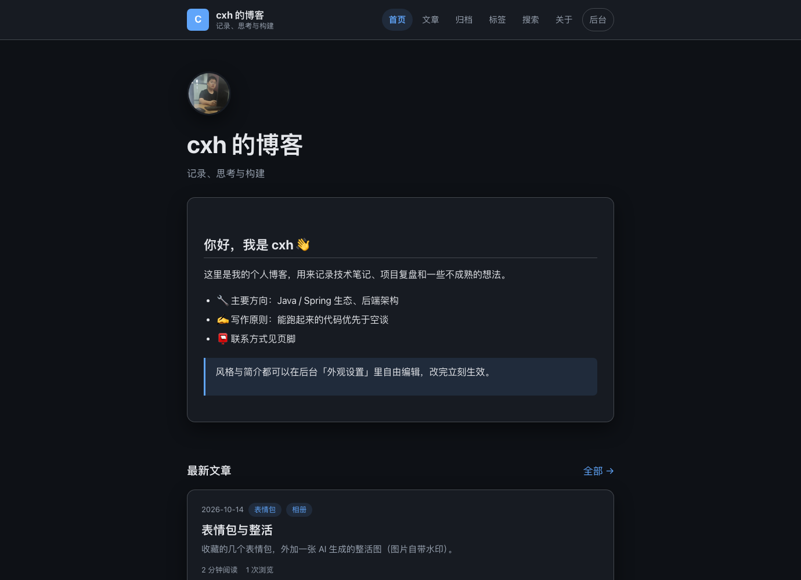
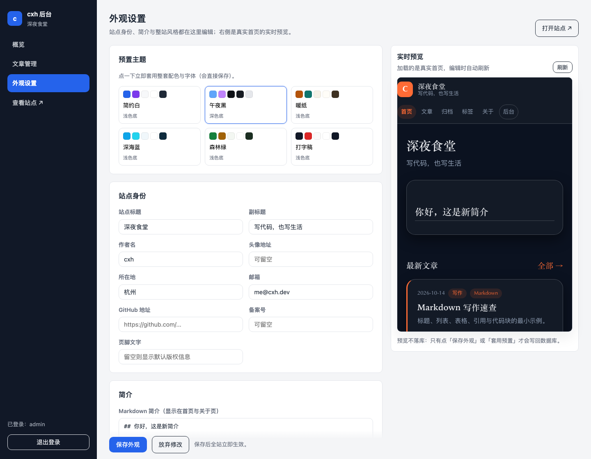
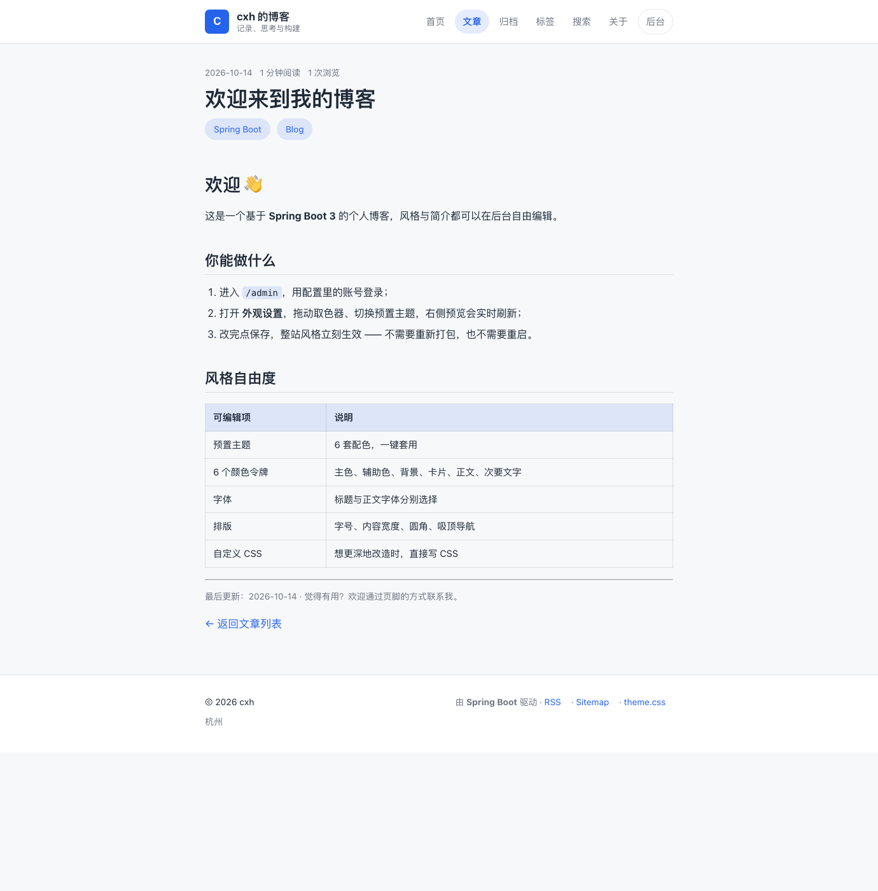
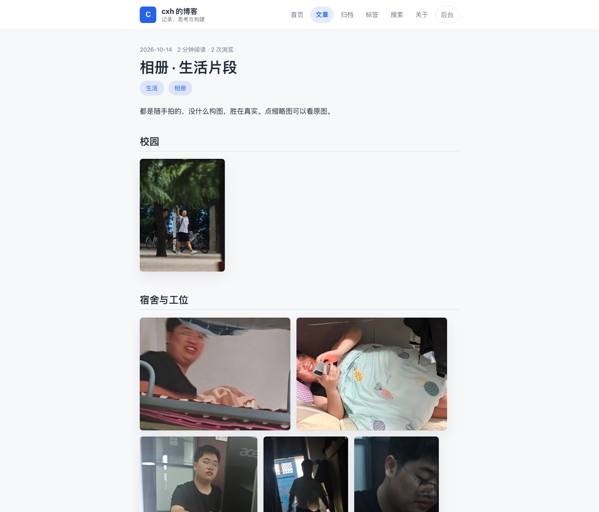
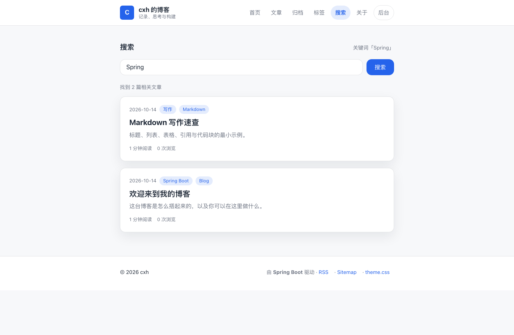

# cxh 个人博客系统

基于 **Spring Boot 3.5** 的个人博客，核心特色是——**站点风格与简介可以在后台自由编辑，保存后全站立即生效**（不需要重新打包，也不需要重启）。

代码组织遵循「按业务能力垂直切分 + 依赖单向向内」，`site`（站点域）与 `post`（文章域）互不引用，扩展点全部收敛在接口上。

```
编辑表单 → SiteProfileForm → ThemeTokens（校验/规范化）→ 数据库
                                                        ↓
模板（只认 --cxh-* 变量）←  /theme.css  ← ThemeStyleRenderer ← SiteProfileView
```

---

## 1. 技术栈

| 领域 | 选型 | 说明 |
| --- | --- | --- |
| 语言 / 运行时 | Java 17（构建目标），已在 JDK 17 与 JDK 26 上实测 | 编译目标锁定 17，兼容更高版本 JDK |
| 框架 | Spring Boot 3.5.16 | Web / Validation / Data JPA / Security / Actuator |
| 视图 | Thymeleaf + 原生 CSS | **零前端构建**：没有 npm、没有打包步骤 |
| 持久化 | Spring Data JPA + H2（默认文件库）/ MySQL 8+（profile 切换） | 上层只依赖仓储接口 |
| 表结构 | Flyway（`db/migration/{h2,mysql}`），Hibernate 只做 `validate` | 结构变更可版本化、可回放，启动即校验 |
| 部署 | Maven Wrapper + Dockerfile + docker-compose（app + MySQL） | 本机零安装也能跑，容器里一条命令起 |
| 安全 | Spring Security 会话登录（单管理员，BCrypt） | 默认拒绝 + 白名单放行 |
| Markdown | CommonMark + GFM 表格扩展 | 通过 `MarkdownRenderer` 接口注入 |

---

## 2. 快速开始

```bash
# 方式一：启动脚本（推荐；jar 不存在时会自动构建）
scripts/run.sh -d          # 后台启动，日志在 logs/app.log，PID 在 logs/app.pid
scripts/run.sh status      # 查看是否在运行 + 健康检查
scripts/run.sh stop        # 停止后台实例
scripts/run.sh             # 不加参数 = 前台启动，Ctrl+C 停止

# 方式二：直接运行（仓库自带 Maven Wrapper，无需本机安装 Maven）
./mvnw spring-boot:run

# 方式三：打包后运行
./mvnw clean package
java -jar target/cxh-blog.jar
```

> 注意：`java -jar ... &` 这种在别的 shell 里起的进程，可能随该 shell 退出而被回收，
> 表现为浏览器报 `ERR_CONNECTION_REFUSED`。需要常驻就用 `scripts/run.sh -d`（写 PID 文件、可 status/stop），
> 或交给 systemd / launchd / Docker 管理。

打开：

- 前台 <http://localhost:8080/>
- 后台 <http://localhost:8080/admin> —— 默认账号 `admin` / 密码 `cxh@2024`

首次启动会自动创建 H2 文件库（`./data/cxh-blog.mv.db`）——表结构由 Flyway 脚本建立，
随后写入默认站点档案与 5 篇示例文章（含两个图片集：生活相册、表情包）。
把 `cxh.seed.enabled` 设为 `false`，或删除 `./data` 目录，即可得到一座干净的博客。

> 环境要求：JDK 17 及以上。首次构建需要联网下载依赖。
> 换端口：`PORT=9090 scripts/run.sh -d`。
> 想直接上生产：`docker compose up -d --build`（见 7.4）。

---

## 3. 功能一览

**前台**

- 首页：大标题 + Markdown 简介（Hero 可开关）+ 最新文章 + 标签云
- 文章列表（分页）、文章详情（Markdown 渲染、阅读量、阅读时长）、归档（按年份分组）、标签页、关于页
- **站内搜索**：检索已发布文章的标题、摘要与正文；LIKE 通配符被转义，输入 `%` 不会退化成全表扫描
- **图片相册**：文章里用 `[](原图)` 即可排成照片墙（纯 Markdown，无需脚本；点击缩略图看原图）
- **RSS 订阅** `/feed.xml`、**站点地图** `/sitemap.xml`、`/robots.txt`（SEO / 订阅）
- 统一错误页（400 / 403 / 404 / 500），区分页面请求与 `Accept: application/json` 请求

**写作**

- Markdown 正文 + **实时预览**：预览与发布用的是同一个 `MarkdownRenderer`，所见即所得
- 摘要留空自动截取；slug 留空按标题生成，冲突自动加后缀
- 草稿 / 发布两种状态，草稿不进入任何公开页面
- 标签（支持中英文逗号、顿号、井号、分号分隔，自动去重、限长、限 8 个）

**外观自由编辑**（本项目重点）

- 账号体系：注册（用户名/邮箱/密码/确认密码/图形验证码）、用户名或邮箱+密码登录、邮箱验证码登录
- 普通用户可发文、点赞；管理员 admin 登录后进入后台
- 6 套预置主题 + 8 套快捷配色盘，点一下立即套用整套配色与字体
- 后台「配色盘」：8 套快捷配色一键填满 6 个取色器，还能按主色推导整套协调配色
- 页面留白处有轻声生长的花朵（纯 SVG 描边动画，跟随主题色，尊重「减少动效」）
- 6 个颜色令牌：主色、辅助色、页面背景、卡片背景、正文字色、次要文字色
- 标题字体 / 正文字体分别选择（服务端白名单字体栈，不请求外部字体）
- 排版：正文字号、内容宽度、圆角、顶栏吸顶、首页 Hero 开关
- 站点身份：站点标题、副标题、作者名、头像、所在地、邮箱、GitHub、备案号、页脚文字
  （头像会渲染在首页 Hero 区与关于页；留空则整块不渲染）
- Markdown 简介（作用于首页与关于页）
- 自定义 CSS（可用 `--cxh-*` 变量）
- **实时预览**：右侧 iframe 加载的是真实首页，编辑时自动刷新；预览不落库

**后台**

- 概览：文章总数 / 已发布 / 草稿 / 累计浏览
- 文章管理：列表筛选、新建、编辑、删除、状态切换

### 图片与相册

图片放在 `src/main/resources/static/images/gallery/`（原图）与 `.../thumbs/`（缩略图），
在文章正文里用 Markdown 的「图片套链接」写法即可排成照片墙，不需要任何前端脚本：

```markdown
[](/images/gallery/bc01.jpg)
```

- 点击缩略图打开原图；
- 连续的图片段落会被 `blog.css` 的 `:has()` 规则排成等高照片墙，不支持 `:has()` 的浏览器退化为纵向大图；
- 头像在「外观设置 → 头像地址」里填图片路径，会渲染在首页 Hero 区与关于页；留空则整块不渲染；
- 文章「封面图地址」会渲染在详情页正文上方。

**后台上传（推荐）**：文章编辑页点「插入图片」即可上传，成功后自动把
`[](原图)` 插到光标处——图片存到 `cxh.media.location`（默认 `./uploads`），
由 `/uploads/**` 对外提供，**不需要重新构建或重启**。

上传的安全约束：文件名一律重命名为 UUID（杜绝路径穿越）、以真实解码结果判定类型
（不信任客户端声明的 Content-Type）、类型白名单 jpeg/png/gif/webp、单张上限 8MB、
仅管理员可调用（`/api/**` 需 ROLE_ADMIN + CSRF 令牌）。

> 也可以继续用「图片放进 static/images/gallery 随包发布」的方式，适合长期不变的内置图。

---

## 4. 架构：高内聚低耦合怎么落地

### 4.1 按业务能力分包，而不是按技术分层

```
com.cxh.blog
├── common/          通用能力（不依赖任何业务包）
│   ├── api/         ApiResponse、PageResult
│   ├── exception/   BusinessException、GlobalExceptionHandler
│   ├── render/      MarkdownRenderer（接口）+ CommonMark 实现
│   ├── text/        Slugs、DateTimes、XmlText
│   └── web/         RequestTypes
├── site/            站点域：站点身份 + 简介 + 主题风格
│   ├── domain/      SiteProfile、ThemeTokens、ThemePreset、FontChoice、HexColor
│   ├── repository/  SiteProfileRepository
│   ├── service/     SiteProfileService（接口）+ impl
│   ├── dto/         SiteProfileForm / SiteProfileView / ThemePresetOption / FontOption
│   ├── theme/       ThemeStyleRenderer（接口）+ CssVariables 实现
│   └── web/         SitePublicController（/theme.css）、SiteAdminController（外观后台）
├── post/            文章域：写作、发布、归档、检索
│   ├── domain/      Post、PostDraft、PostStatus、Tags、SearchKeyword
│   ├── repository/  PostRepository
│   ├── service/     PostService（接口）+ impl
│   ├── dto/         PostForm / PostSummary / PostDetail / PostStats
│   └── web/         PostPublicController、PostAdminController
├── security/        管理员认证与授权（AdminProperties、AdminUserDetailsService、SecurityConfig）
├── web/             跨域页面装配（GlobalModelAdvice、HomeController、AdminDashboardController）
│   └── feed/        RssFeedWriter、SitemapWriter（只做序列化，由 FeedController 取数）
└── bootstrap/       启动期种子数据（唯一允许同时依赖多个域的包）
```

每个域内部再按 `domain → repository → service → web` 组织：**域内高内聚，域间零引用**。

数据库结构不放 Java 里，而是 `src/main/resources/db/migration/{h2,mysql}/V1__init.sql`：
**存储层的能力（Flyway）可以被替换而不触碰任何业务代码** —— 这正是分层的收益。

### 4.2 依赖方向单向向内

```
web / bootstrap  →  site / post  →  common
```

| 规则 | 落地方式 | 收益 |
| --- | --- | --- |
| `post` 不认识 `site`，反之亦然 | 两个域之间没有任何 import | 改站点风格不需要回归文章功能 |
| 跨域协作只发生在装配层 | `HomeController` 同时用两个域；`AdminDashboardController` 汇总统计；`FeedController` 组合站点档案与文章 | 耦合点数量可控、位置固定 |
| 控制器只依赖服务接口 | `PostService` / `SiteProfileService` 均为 interface + impl | 实现可替换（加缓存、换存储）而调用方零改动 |
| 渲染能力依赖倒置 | `MarkdownRenderer`、`ThemeStyleRenderer` 都是接口，由 `common` / `site.theme` 提供实现 | 换渲染器不动业务代码 |
| 输入规则收敛为值对象 | `SearchKeyword`（转义 LIKE 通配符）、`Tags`（标签解析）、`HexColor`（颜色校验） | 规则只写一遍，仓储/模板不再各自处理输入 |
| 序列化与取数分离 | `RssFeedWriter` / `SitemapWriter` 只做 XML 输出，不查库 | 可以单测、可以复用（将来加 JSON Feed 不用改控制器） |
| 模板不接触实体 | 只暴露 `SiteProfileView` / `PostSummary` / `PostDetail` 等读模型 | 实体可演进，页面不受影响 |

**判据**：改一个需求，需要同时打开的文件越少，内聚越高。

### 4.3 数据契约（写模型 / 读模型分离）

| 契约 | 位置 | 作用 |
| --- | --- | --- |
| `SiteProfileForm` | `site.dto` | 外观编辑表单 → 站点域的唯一写入口，所有校验注解在此声明 |
| `ThemeTokens` | `site.domain` | 「风格」的唯一载体，`normalize()` 是写入数据库前的最后一道防线 |
| `SiteProfileView` | `site.dto` | 页面能看到的站点信息（含渲染好的简介 HTML） |
| `PostForm` / `PostDraft` | `post.dto` / `post.domain` | 表单 → 领域编辑意图，实体方法签名因此保持稳定 |
| `PostSummary` / `PostDetail` | `post.dto` | 列表用与详情用两个读模型，列表查询不必带出正文 |
| `PageResult` / `ApiResponse` | `common.api` | 屏蔽 Spring Data `Page`，统一接口返回结构 |

### 4.4 唯一的前后端耦合点

`web/GlobalModelAdvice` 把当前站点档案注入**每个**页面的模型：

```java
@ModelAttribute
public void injectSiteProfile(Model model) {
    model.addAttribute("site", siteProfileService.current());
}
```

于是模板统一写 `${site.siteTitle}`、`${site.introHtml}`，各控制器完全不必关心站点配置，站点域也不必知道有哪些页面存在。

---

## 5. 风格系统是怎么工作的

### 5.1 数据流（单向、可预测）

1. 后台表单提交 → `SiteProfileForm`（Bean Validation 校验：颜色必须 `#RGB`/`#RRGGBB`、字体必须是枚举、数值必须在区间内）；
2. `form.toThemeTokens()` → `ThemeTokens.normalize()` 再次收敛非法值（**防御式校验**，不允许绕过）；
3. `SiteProfile.edit(...)` 写入实体并落库，同时刷新进程内读模型快照；
4. `ThemeStyleRenderer` 把令牌渲染成 `:root { --cxh-*: ... }`，再拼上自定义 CSS，由 `GET /theme.css` 以 `text/css` 返回（`Cache-Control: no-store`）；
5. 模板只消费 `--cxh-*` 变量，`static/css/blog.css` 中**没有任何硬编码色值**。

编辑期间的实时预览走的是同一条链路（`POST /admin/appearance/preview` → 同一个 `ThemeStyleRenderer`），因此「预览所见」与「保存所得」必然一致。

### 5.2 可用的 CSS 变量

| 变量 | 含义 |
| --- | --- |
| `--cxh-primary` / `--cxh-primary-soft` | 主色 / 主色柔光（按钮、链接、标签） |
| `--cxh-accent` | 辅助色 |
| `--cxh-bg` / `--cxh-surface` | 页面背景 / 卡片背景 |
| `--cxh-text` / `--cxh-muted` | 正文色 / 次要文字色 |
| `--cxh-border` / `--cxh-shadow` | 描边与阴影（由令牌自动派生） |
| `--cxh-font-heading` / `--cxh-font-body` | 标题 / 正文字体栈 |
| `--cxh-font-size` / `--cxh-content-width` | 字号 / 内容宽度 |
| `--cxh-radius` / `--cxh-radius-sm` / `--cxh-radius-lg` | 圆角 |
| `--cxh-header-position` | 顶栏定位（吸顶或静态） |

自定义 CSS 示例：

```css
.post-card { border-left: 3px solid var(--cxh-primary); box-shadow: none; }
.hero__intro { background: var(--cxh-surface); }
```

### 5.3 扩展方式

| 需求 | 需要改动的地方 |
| --- | --- |
| 新增一套预置主题 | 在 `ThemePreset` 加一个枚举常量（6 个色值 + 2 个字体），再补一条 Flyway 迁移把新值加进 `chk_theme_preset` |
| 新增一种字体 | 在 `FontChoice` 加一个枚举常量 |
| 新增一个风格维度（例如「密度」） | `ThemeTokens` 加字段 → `SiteProfileForm` 加字段与校验 → `CssVariablesThemeStyleRenderer.variables()` 加一个变量 → `appearance.html` 加一个控件 |
| 换掉渲染方式（例如输出 JSON 给构建期） | 换一个 `ThemeStyleRenderer` 实现即可，模板与业务代码不动 |
| 换 Markdown 引擎 | 换一个 `MarkdownRenderer` 实现即可 |
| 新增一类订阅输出（JSON Feed、Atom） | 加一个 Writer + 在 `FeedController` 加一个路由；取数仍走 `PostService`，不新增查询 |
| 把 LIKE 搜索换成全文索引 | 只改 `PostRepository` 的查询与 `PostServiceImpl.search`，控制器与模板零改动 |

---

## 6. HTTP 接口

| 方法 | 路径 | 权限 | 说明 |
| --- | --- | --- | --- |
| GET | `/` | 公开 | 首页 |
| GET | `/posts`、`/posts/{slug}` | 公开 | 文章列表 / 详情 |
| GET | `/tags`、`/tags/{tag}` | 公开 | 标签云 / 按标签检索 |
| GET | `/search?q=关键词` | 公开 | 站内搜索（标题 / 摘要 / 正文） |
| GET | `/archive`、`/about` | 公开 | 归档 / 关于 |
| GET | `/theme.css` | 公开 | **按当前风格实时生成的样式表** |
| GET | `/feed.xml` | 公开 | RSS 2.0 订阅（最近 20 篇） |
| GET | `/sitemap.xml` | 公开 | 站点地图（静态页 + 标签 + 文章） |
| GET | `/robots.txt` | 公开 | 爬虫规则，指向 sitemap |
| GET | `/login`、POST `/login`、POST `/logout` | 公开 | 会话登录 / 退出 |
| GET | `/admin` | ADMIN | 后台概览 |
| GET | `/admin/posts`、`/admin/posts/new`、`/admin/posts/{id}/edit` | ADMIN | 文章管理页 |
| POST | `/admin/posts`、`/admin/posts/{id}/delete` | ADMIN | 保存 / 删除文章 |
| POST | `/admin/posts/preview` | ADMIN | Markdown 实时预览（返回 HTML） |
| GET / POST | `/admin/appearance` | ADMIN | 外观编辑页 / 保存外观 |
| POST | `/admin/appearance/preset` | ADMIN | 一键套用预置主题 |
| POST | `/admin/appearance/preview` | ADMIN | 实时预览（返回 CSS） |
| GET | `/admin/appearance/presets` | ADMIN | 预置主题列表（JSON） |
| GET | `/actuator/health` | 公开 | 健康检查 |

---

## 7. 配置与部署

### 7.1 关键配置（`src/main/resources/application.yml`）

```yaml
server:
  port: ${SERVER_PORT:8080}
  forward-headers-strategy: framework          # 反向代理后能推导出正确的站点地址
spring:
  jpa:
    hibernate:
      ddl-auto: validate                       # 表结构由 Flyway 管理，Hibernate 只校验
  flyway:
    locations: classpath:db/migration/{vendor} # {vendor} → h2 / mysql
    baseline-on-migrate: true
cxh:
  admin:
    username: ${CXH_ADMIN_USERNAME:admin}
    password: ${CXH_ADMIN_PASSWORD:cxh@2024}   # 支持明文或 $2a$... BCrypt 摘要
    display-name: 站长
  seed:
    enabled: true                              # 是否写入示例文章
```

生产环境请务必覆盖管理员密码：

```bash
export CXH_ADMIN_PASSWORD='一个足够强的密码'
java -jar target/cxh-blog.jar --spring.profiles.active=mysql
```

### 7.2 数据库结构由 Flyway 管理

| 文件 | 作用 |
| --- | --- |
| `db/migration/h2/V1__init.sql` | H2 建表（默认开发库） |
| `db/migration/mysql/V1__init.sql` | MySQL 建表（结构一一对应，只差方言） |

- 启动顺序是 **Flyway 迁移 → Hibernate `validate`**，所以脚本与实体的映射只要有一处不一致就会启动失败（这是刻意设计的护栏）；
- 测试环境也走 Flyway（`ddl-auto: validate`），因此每次 `./mvnw test` 都在顺带验证建表脚本；
- 改结构请**新增** `V2__xxx.sql`，不要修改已发布的脚本；
- 枚举列统一是 `varchar + check` 约束（实体上显式 `@JdbcTypeCode(SqlTypes.VARCHAR)`），避免 H2/MySQL 各建各的原生 `enum` 类型——那样 schema 不可移植，新增一个枚举常量还得 `ALTER TABLE`。

### 7.3 切换到 MySQL

```sql
CREATE DATABASE cxh_blog DEFAULT CHARACTER SET utf8mb4 COLLATE utf8mb4_general_ci;
```

```bash
java -jar target/cxh-blog.jar --spring.profiles.active=mysql \
  --DB_HOST=127.0.0.1 --DB_USERNAME=cxh --DB_PASSWORD=***
```

> `characterEncoding` 必须是 Java 字符集名 **`UTF-8`**；写 `utf8mb4` 会被 Connector/J 直接拒绝
> （`Unsupported character encoding 'utf8mb4'`）。真正的 utf8mb4 由服务端和上面的建库语句保证。

### 7.4 Docker 部署

```bash
docker compose up -d --build      # 应用 + MySQL 8.4
# 前台 http://localhost:8080 ，后台 /admin
```

| 文件 | 说明 |
| --- | --- |
| `Dockerfile` | 两阶段构建（Maven 构建 → JRE 运行），非 root 用户启动，带 HEALTHCHECK |
| `docker-compose.yml` | app + mysql，app 等 MySQL 健康后再启动，密码全部可用环境变量覆盖 |
| `.dockerignore` | 排除 `target/`、`data/`、`docs/` 等，缩小构建上下文 |

验证边界（诚实说明）：本仓库的开发环境**没有运行中的 Docker daemon，且无法访问 Docker Hub**，因此
`docker build` / `docker compose up` 未能实际执行。已验证的是：`docker compose config` 语法与插值通过；
Dockerfile 里的运行时假设被逐条本地复刻验证（`SERVER_PORT` 覆盖端口、`ENTRYPOINT` 的 `java $JAVA_OPTS -jar`、
HEALTHCHECK 的 `curl .../actuator/health | grep '"status":"UP"'`、`-XX:MaxRAMPercentage` 与 `-Duser.timezone` 均生效）。

### 7.5 安全说明

- 路径策略为 **默认拒绝 + 白名单**：未在 `SecurityConfig.PUBLIC_PATHS` 中声明的一律拒绝，新增页面必须显式表态；
- CSRF 默认开启，模板中的表单由 Thymeleaf 自动注入隐藏字段，AJAX 请求从 `<meta name="_csrf">` 取令牌；
- 颜色只能取十六进制、字体只能取枚举、数值必须落在区间内，避免把任意字符串拼进 CSS；
- 简介与正文中的原始 HTML 会被 CommonMark 转义，样式自由度收敛到受控的 CSS 通道；
- H2 控制台仅在默认（H2）配置下启用，MySQL profile 中已关闭；
- 后台刻意**不套用前台主题**：即使把前台配色调到极端，后台依然可读可操作。

---

## 8. 测试

本项目有四层测试，全部可重复执行：

```bash
./mvnw test                          # 93 个单元/集成测试（含 JaCoCo 覆盖率报告）
scripts/acceptance-test.sh           # 110 条端到端验收用例（自动起停应用）
# 覆盖率报告：target/site/jacoco/index.html
```

**覆盖率（JaCoCo 0.8.15）**：指令 89.7%、行 **90.8%**（1178/1297）、分支 65.2%、方法 91.7%；
新增的 `media` 包（图片上传）行覆盖 88.2%，`media.web` 87.5%。
分支缺口集中在无法确定性触发的 5xx 分支与部分防御性回退。

| 测试类 | 用例 | 覆盖内容 |
| --- | --- | --- |
| `CssVariablesThemeStyleRendererTest` | 6 | 令牌 → CSS 变量、自定义 CSS 追加顺序、非法颜色/越界数值的收敛、字体白名单 |
| `PostTest` | 5 | 标签解析（含中文分隔符与空格标签）、slug 生成、发布状态与时间、阅读量、非法标题被拒 |
| `SearchKeywordTest` | 4 | LIKE 通配符（`%` `_` `!`）转义、长度截断、空白规范化、纯符号关键词不触发查询 |
| `AdminUserDetailsServiceTest` | 4 | 明文口令加密、BCrypt 摘要、`{bcrypt}` 前缀、未知账号被拒 |
| `AuthFlowTest` | 7 | 注册页与验证码可匿名访问、正确验证码可注册、错误验证码被拒、邮箱登录、验证码登录、点赞切换、匿名不能发文 |
| `SiteProfileServiceTest` | 6 | 默认档案自举、编辑落库与快照刷新、预览不落库、套用预置保留排版参数、非法颜色不落库 |
| `PostServiceTest` | 10 | 保存与渲染、slug 唯一性、草稿隔离、阅读量累加、标签检索、**搜索命中与通配符防御**、分页防御、删除、编辑复用记录 |
| `SeedDataTest` | 5 | 首启动写入 5 篇示例文章、相册渲染出缩略图与原图链接、内容可检索、站点档案自举、种子幂等 |
| `PublicPagesTest` | 12 | 首页 / 列表 / 详情 / 标签 / 归档 / 关于 / 搜索可渲染、`/theme.css` 输出与缓存头、**样式级联顺序守卫**、头像按配置渲染/清除、相册图片与缩略图随包可访问、关键词 HTML 转义、404 页面、后台未登录跳转、登录页可匿名访问 |
| `AdminWebTest` | 7 | 概览、外观编辑器渲染全部控件、预览接口不写库、保存后 `/theme.css` 与前台的即时变化、非法颜色被校验拦下、Markdown 预览接口、后台文章页 |
| `ErrorHandlingTest` | 12 | 非法枚举/路径变量/分页参数 → 400、方法不支持 → 405、错误页表达式、JSON 错误结构、超长正文、友好绑定提示、安全响应头（nosniff / X-Frame-Options / CSP）、actuator 拒绝、CSRF、模板无内联事件 |
| `FeedEndpointsTest` | 4 | `/feed.xml`、`/sitemap.xml`、`/robots.txt`；**用 XML 解析器真的解析一遍**（含 `&`、`<`、`"` 的标题）、草稿不入订阅、sitemap 含 lastmod |

验收脚本按 10 组共 110 条用例覆盖公开页面、样式表、订阅、鉴权与安全基线、登录流程、
文章管理、外观自由编辑、异常与边界输入、数据完整性，逐条结果见
[docs/acceptance-test-result.txt](docs/acceptance-test-result.txt)。

### 8.1 完整性测试发现的缺陷

| 编号 | 现象 | 根因 | 修复 |
| --- | --- | --- | --- |
| BUG-02 | `?status=INVALID`、`/admin/posts/abc/edit`、`?page=abc` 返回 500 | 类型不匹配异常落入兜底分支 | 新增处理器返回 400 |
| BUG-03 | 40000 字正文 500；错误页标题打印出 `null ?: 'cxh 的博客'` | 正文缺少长度上限；Elvis 兜底写在字面量替换内部 | 加 `@Size(15000)` 与错误回显位；表达式整体移入 `${}` |
| BUG-04 | 并发保存同名文章 3/4 请求 500 | 唯一约束冲突未翻译 | 新增 `DataIntegrityViolationException` 处理器返回 409 |
| BUG-05 | MySQL profile 无法启动 | 连接串 `characterEncoding=utf8mb4` 被 Connector/J 拒绝 | 改为 `UTF-8` |
| BUG-06 | 枚举列被建成原生 enum 类型 | Hibernate 6 默认行为 | 显式 `@JdbcTypeCode(SqlTypes.VARCHAR)` |

（BUG-01 样式级联顺序缺陷见 11.2 的验证记录。）

### 8.2 软件说明书

按软件工程课程要求编写的说明书见
[docs/cxh个人博客系统-软件说明书.docx](docs/cxh个人博客系统-软件说明书.docx)，
由 [docs/build-manual.py](docs/build-manual.py) 生成，可随代码变更重新产出。

除单元/集成测试外，本项目还用**真实的 MySQL 实例**与**真实浏览器**做过端到端验证（见 11.3）。

---

## 9. 界面预览

| 默认风格（首次启动，含头像） | 一键套用「午夜黑」后 |
| --- | --- |
|  |  |

| 外观设置 + 实时预览 | 文章详情（Markdown 渲染） |
| --- | --- |
|  |  |

| 图片相册（缩略图墙，点击看原图） | 站内搜索 |
| --- | --- |
|  |  |

> 外观编辑器的预览区展示的是**真实首页**：拖动取色器的瞬间，右侧 iframe 里的品牌色就从青色变成了橙色，而数据库毫未改动 —— 只有点「保存外观」才会写回。

---

## 10. 目录结构

```
cxh/
├── mvnw / mvnw.cmd           Maven Wrapper（无需本机安装 Maven）
├── pom.xml
├── Dockerfile                两阶段构建镜像
├── docker-compose.yml        开发/单机：app + MySQL 一键启动
├── deploy/                   生产部署：Nginx 反代配置、prod 编排、.env 模板
├── .dockerignore
├── data/                     H2 文件库（运行后生成，已 gitignore）
├── uploads/                  后台上传的图片（运行后生成，已 gitignore）
├── backups/                  备份产物（已 gitignore）
├── scripts/run.sh              启动/停止/状态（含自动构建）
├── scripts/acceptance-test.sh  110 条端到端验收用例（自动起停应用）
├── scripts/backup.sh           数据库 + 上传图片备份（含过期清理）
├── deploy/                     生产部署（Nginx 反代、compose、.env 模板）
├── docs/
│   ├── build-manual.py            生成软件说明书的脚本
│   ├── cxh个人博客系统-软件说明书.docx  课程软件工程说明书（32 页）
│   ├── acceptance-test-result.txt 验收测试逐条记录
│   └── screenshots/               界面截图（README 引用）
├── src/main/java/com/cxh/blog/…
├── src/main/resources/
│   ├── application.yml            默认：H2 文件库 + Flyway
│   ├── application-mysql.yml      MySQL profile
│   ├── db/migration/h2/V1__init.sql      H2 建表脚本
│   ├── db/migration/mysql/V1__init.sql   MySQL 建表脚本
│   ├── static/images/gallery/     相册原图（11 张）+ thumbs/ 缩略图
│   ├── static/css/blog.css        前台样式（只消费 --cxh-* 变量）
│   ├── static/css/admin.css       后台样式（独立调色板 --a-*）
│   ├── static/js/appearance.js    外观实时预览
│   ├── static/js/markdown-preview.js
│   └── templates/
│       ├── layout/base.html       前台骨架（head / header / footer / 文章卡片片段）
│       ├── layout/admin.html      后台骨架（含 CSRF meta）
│       ├── index.html · posts.html · post.html · tags.html · archive.html · about.html · search.html
│       ├── error.html
│       └── admin/login.html · dashboard.html · posts.html · post-form.html · appearance.html
└── src/test/java/com/cxh/blog/…
```

---

## 11. 已知边界与验证记录

### 11.1 边界

- 单站点、单管理员模型：`site_profile` 固定一行，账号来自配置而非数据库；若要多站点/多作者，需要引入 `tenant`/`user` 维度；
- 站点档案用进程内快照缓存（写操作后替换），多实例部署时应换成共享缓存或短 TTL；
- 搜索是 `LIKE` 模糊匹配，数据量大时应换成全文索引（MySQL FULLTEXT / Elasticsearch）——换的时候只需替换 `PostRepository` 的查询与服务实现；
- 自定义 CSS 以管理员为信任边界，未做 CSS 语法白名单（如需强隔离，可将前台放到独立域名的 iframe 中）；
- Flyway 11.x 官方支持到 MySQL 8.1，在 MySQL 9.7 上会打印 “upgrade recommended” 警告但迁移实测正常（见 11.3）；追求零警告可固定 `flyway.version` 到更新的版本；
- Docker 镜像构建未在本环境执行（无 daemon、Docker Hub 不可达），见 7.4 的验证边界说明；
- 安全策略为默认拒绝，因此白名单外的未知路径会跳转登录页（302）而不是返回 404（见 3.5 与验收用例 D06）；
- 软件说明书的**版面视觉**只核对了封面页：本环境的 LibreOffice 位图渲染对最小样例文档同样输出空白页（已用对照实验确认，属渲染链路问题而非文档缺陷），因此其余页面改用结构校验 + PDF 文本算子统计替代（32 页、5924 个文本绘制算子、26 张表格），并核对了全部表格列宽合计 15.0cm < 可用宽度 15.8cm，无溢出风险。

### 11.2 验证方式

| 层级 | 手段 |
| --- | --- |
| 单元 / 集成 | `./mvnw test`，74 个测试 + JaCoCo 覆盖率（H2 内存库，表结构由 Flyway 脚本创建并校验） |
| 完整性 / 验收 | `scripts/acceptance-test.sh`，110 条用例在干净数据库上启动真实 jar 逐条校验，110/110 通过 |
| 网页渲染 | MockMvc 断言真实渲染出的 HTML；XML 输出用解析器实际解析 |
| 端到端（H2） | 启动真实 jar，curl 走通登录 → 编辑外观 → 预览 → 保存 → 前台生效；重启后配置仍在 |
| 端到端（MySQL） | 独立临时实例（端口 3399）跑通迁移、中文/emoji 落库、搜索、订阅、重启幂等 |
| 浏览器行为 | CDP 驱动真实浏览器：登录后台、检查编辑器控件与 iframe 注入、模拟拖动取色器验证预览实时更新（加入 CSP 后复测仍通过） |
| 样式正确性 | 无头浏览器截图肉眼核对（据此发现并修掉了「兜底 CSS 覆盖主题变量」的级联顺序缺陷） |
| 缺陷回归 | 每个缺陷都固化为测试：`ErrorHandlingTest`（12 条）对应 BUG-02/03/04，验收用例对应 BUG-05/06/07 |

### 11.3 MySQL 实测记录

在临时 MySQL **9.7.1** 实例上（`--initialize-insecure` 独立数据目录，不触碰本机已有实例）：

| 检查项 | 结果 |
| --- | --- |
| Flyway 迁移 | `Migrating schema cxh_blog to version "1 - init"` → `Successfully applied 1 migration` |
| Hibernate `validate` | 通过，无 `Schema-validation` 报错 |
| 表结构 | `site_profile` / `post` / `post_tag` / `flyway_schema_history` 全部生成 |
| 中文与 emoji | `MySQL 中文与 emoji 测试 🎉` 原样落库与回显（utf8mb4 正常） |
| 搜索（跨方言） | 命中中文与英文关键词；输入 `%` 返回 0 条（转义生效） |
| 订阅与地图 | `/feed.xml` 200 + `application/rss+xml`；`/sitemap.xml` 含 9 个 URL |
| 二次启动 | `Schema is up to date. No migration necessary.`（幂等），数据仍在 |
